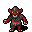

# Rabble Below

A small async auto-battler. Hire a rabble of dungeon misfits, merge them to level up, pick relics, and send
them against the ghosts of other crews. Ten trophies before five lives run out.

## Play

```sh
./play.sh
```

Then open http://127.0.0.1:5173. Ctrl+C stops everything.

`play.sh` uses mise to get the SpacetimeDB CLI (pinned in `mise.toml`), starts a local SpacetimeDB on port 3000
with its data in `.stdb-data/`, publishes the module, builds the client and serves it with Python's static server.
Total footprint is around 100 MB of RAM.

## Playtest reactions

Press **H** anywhere in the game, type a word or two ("huh?", "fun!", "bug"), Enter. Play never stops.
Each reaction saves the exact moment: your words, the run as the server sees it, the screen (down to the
battle frame) and what you had just done.

When you stop `play.sh`, or after 20 quiet minutes, the session's reactions are bundled into
`.playtest/sessions/<time>/SESSION.md` for an agent thread to triage (see `playtest/TRIAGE.md`). Something
that sounds like a bug ("bug", "stuck", "broken"…) goes out at once as its own bundle.

- `?moment=<id>` on the game URL replays a saved moment exactly, read-only. Add `&src=http://host:port` to
  read it from another server, or `&src=<url of a moments/<id>.json>`; `&clean` hides the banner.
- `cd tools && npx tsx playtest.ts status` shows what's waiting; `deliver` bundles it now.
- If `.playtest/webhook` holds a T3 webhook URL, each bundle is posted there and opens a fresh thread.

## How it works

- `server/src/game/` holds the whole rules engine as plain TypeScript: units, items, relics, shop, battle, bot AI.
  The client imports the same files for tooltips.
- `server/src/index.ts` is the SpacetimeDB module. Every shop action and every battle runs in a reducer, with
  `ctx.random` as the only randomness. Each team you field is saved as a ghost; future runs fight those ghosts.
  On first publish the module seeds ~50 bot runs so there is always someone to fight.
- `client/` is a small Vite + vanilla TypeScript app. It subscribes to its own run, replays battles from the
  recorded frames, and calls reducers for every action.
- `tools/feel/` lets an agent watch a moment of the game frame by frame: motion, timing, flicker, how long a fight
  drags. `tools/feel/feel record battle round=8` or `tools/feel/feel record first-turn`, then `feel look`.
  See [tools/feel/README.md](tools/feel/README.md).
- `tools/` holds the balancing tools: a quick bot league (`tools/sim.ts`), the Veteran, and a text version of the game.
  See below.

## Dev loop

`./play.sh` is the copy you play. To change the game, work in your own sandbox: a private SpacetimeDB, database,
client build and port pair, so nothing you do can reach the game you're playing.

```sh
./sandbox up            # start it, or apply your latest code; prints the URL to open
./sandbox rehearse      # check that this branch's code publishes cleanly over your real data
./sandbox down
```

`./sandbox help` lists the rest. Each `./play.sh` backs up the data to `.stdb-backups/` first (the last 5 are kept).
Add bot ghosts to the real game: `mise exec -- spacetimedb-cli call rabble-below seed_more_bots 20`.

## Balancing

`cd tools && npm install` once. They all run the real rules and matchmaking in `server/src/game/`.

- `./play` is the game as a terminal program (`./play new`, `./play help`), for agents or you. `./play hint`
  shows what the Veteran would do.
- `./veteran` runs the Veteran, a search player that tries every option on a copy of the run and fights the
  results. `./veteran league` reports how it fares, what it buys and which choices were real dilemmas;
  `./veteran diff` compares two leagues. It is CPU heavy (a minute or two on 4 cores), so use it to confirm a hunch.
- `npx tsx sim.ts` is the quick league of simple bots, a one-second smoke test.

How to use them together (LLM playtesters with personas first, numbers second) is in the
`balance-check` skill: `.claude/skills/balance-check/SKILL.md`.

## Credits

- Art: [Dungeon Crawl Stone Soup tiles](https://opengameart.org/content/dungeon-crawl-32x32-tiles), CC0.
- Font: [Pixelify Sans](https://fonts.google.com/specimen/Pixelify+Sans), SIL Open Font License.
- Sounds are synthesized in the browser.
